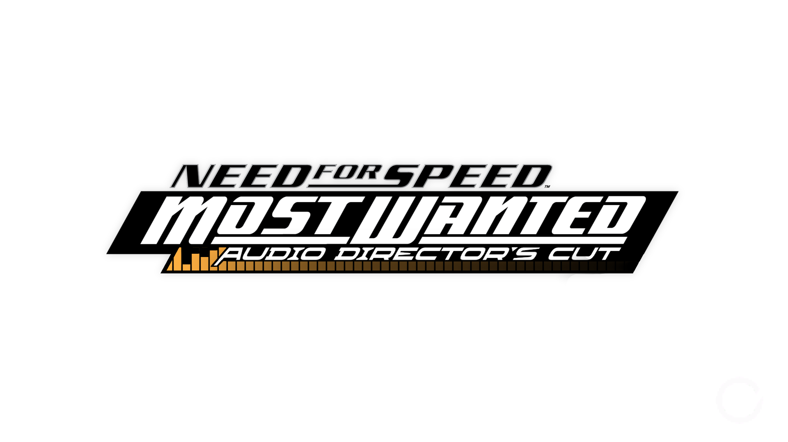

# Audio Director's Cut

[Download the full mod here](https://drive.google.com/file/d/1SmblznAAjvO-gDTUV2Kyp6_ob2w-VQ0n/view?usp=drive_link)

A huge audio overhaul mod that restores the cut pursuit music, cut soundtracks, and even the OPM PS2 demo speeches back into the PC release of Need for Speed: Most Wanted (2005).

## What's in it

**Pursuit music**
- The unused pursuit music from the official soundtrack (High Stakes, Busted, End of the Line and Hitch a Ride) is back, right where the album has it.
- Music you could only hear in the PS2 demo: the drum lead-in when a pursuit kicks off on theme 1, and three extra layers of High Stakes.
- The unused evade and busted stingers.
- The pursuit themes play all the way through now instead of chopping between parts every few seconds. The busted music only kicks in when you're actually about to get busted, theme changes play their whole ending, and after a cooldown the music picks up right where it left off.
- If a song is playing when a pursuit starts, it finishes on its ending and rolls straight into the pursuit music.
- Cooldown actually plays the cooldown music, and the music stays put when you pause or open the map.

**EA Trax**
- Four cut songs are back in the playlist: Weapons of Mass Distortion (The Crystal Method), This Blood (Black Lab), and Super-Charger Heaven and More Human Than Human (White Zombie).

**Cop speech**
- Around 400 cop lines from the OPM PS2 demo, mixed in with the PC ones: screams, hurt cops, EMS calls, arrests, Zulu callsigns and a lot more.
- Ram a cop hard enough and they'll scream, way more often than in the base game, and mostly with the demo screams.
- Get busted and a cop calls in your arrest before the busted cutscene, then dispatch answers.
- Cops call EMS when you take out a bunch of units or the helicopter, without spamming it.

## Install

You'll need the PC version of Most Wanted (v1.3) and ThirteenAG's Ultimate ASI Loader, otherwise it won't load.

1. Back up `SOUND\PFDATA` (`MW_Music.mpf`, `MW_Music.mus`) and `SOUND\SPEECH` (`copspeech.idx`, `copspeech.big`) in your game folder, just in case.
2. Copy the `scripts` and `SOUND` folders into your game folder.
3. If you used Restored Pursuit Music or OPM PS2 Speech Restored before, delete their `.asi` and `.toml` files from `scripts`. This mod replaces both of them.

## Credits

- **eatincrispies:** mod creator
- **xan1242:** info about the music pathfinding, and the idea for songs ending into the pursuit music
- **Roski:** mod tester
- **ThirteenAG:** Ultimate ASI Loader
- **Maxwell** - Custom Logo Art

All the music and speech belong to EA Black Box and the original artists.
